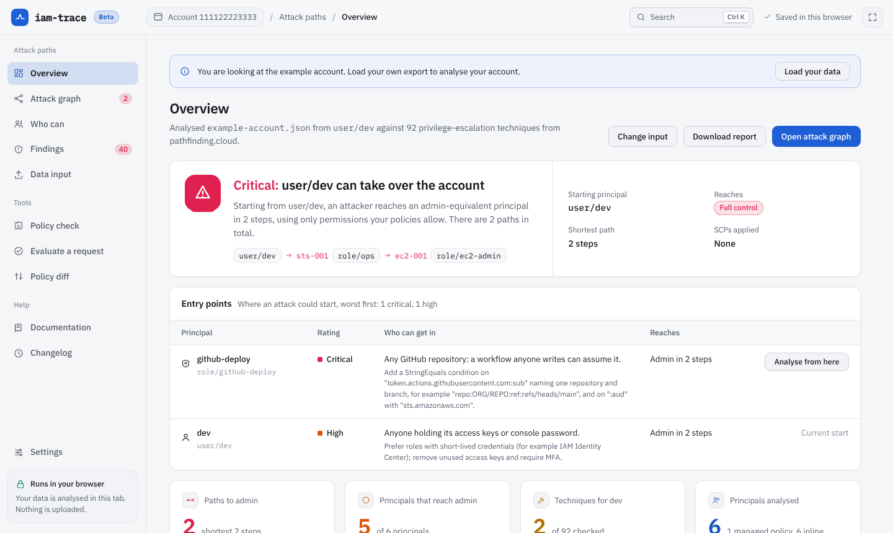
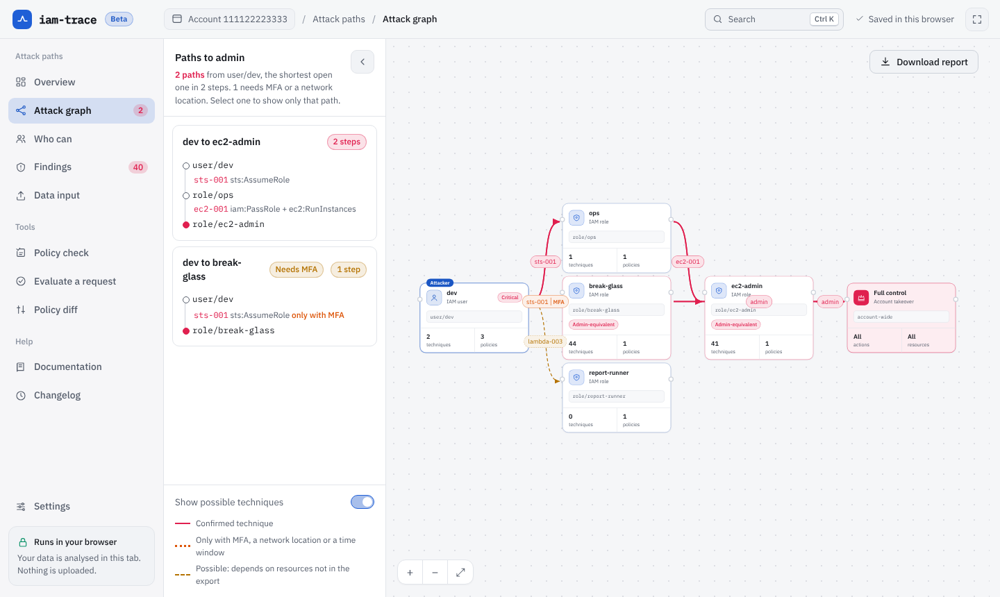
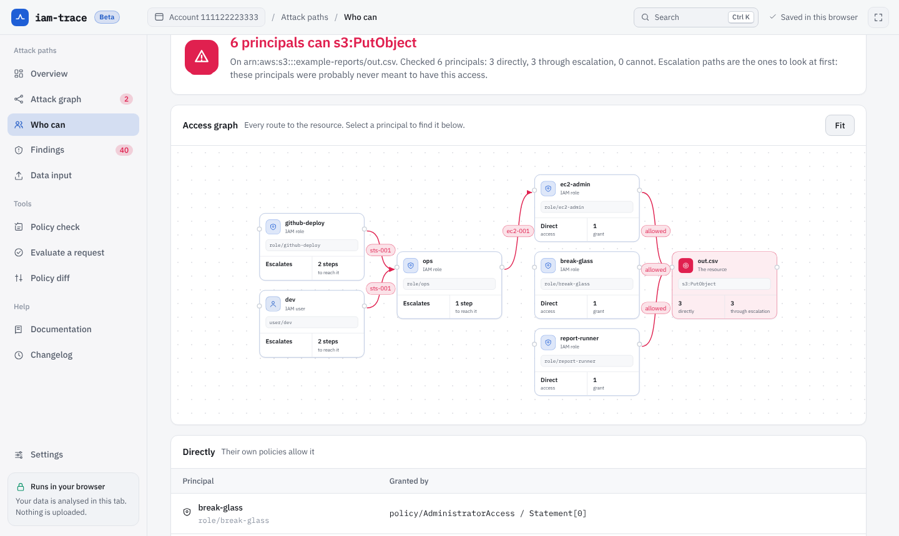
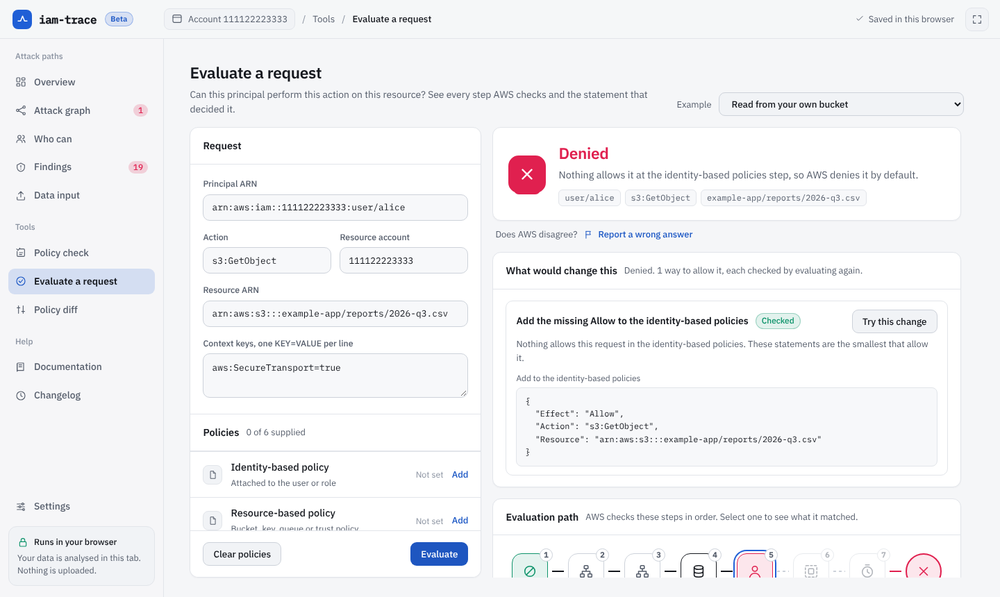

# iam-trace

[](https://github.com/w3bcooki3/iam-trace/actions/workflows/ci.yml)
[](https://w3bcooki3.github.io/iam-trace/)
[](LICENSE)


iam-trace explains what AWS IAM policies allow. It answers five questions:

1. **Can principal P do action A on resource R?** Yes or no, with a trace of the evaluation step
   and the statement that decided it.
2. **What does this policy change actually grant?** A semantic diff: newly allowed and denied
   actions and resources, grouped by access level. Reordering statements is not a change.
3. **If this principal is compromised, what can an attacker do?** Known privilege-escalation
   techniques, multi-step paths to admin-equivalent principals, and the blast radius.
4. **Who can do this?** Every principal that can perform an action on a resource, directly or
   by escalating to someone who can. And for any one request: what would change the answer.
5. **What in this policy is risky?** Patterns such as full admin, `iam:PassRole` on any role,
   public principals and actions that match nothing, each with the reason and a fix.

The engine is a typed Python package with no dependencies. It makes no network calls when it
evaluates, so the same code runs in the CLI, in CI and in the browser.

**Beta.** iam-trace is tested against every worked example in AWS's documentation and hundreds of
other cases, but it has not yet been compared case by case with AWS's own policy simulator (see
"Differential testing"). Use it alongside your existing reviews, not instead of them.

Try it in the browser: <https://w3bcooki3.github.io/iam-trace/>. Nothing is uploaded.



## Who it is for

Developers and small teams who look after AWS accounts without a dedicated security engineer, and
security engineers who want a quick, explainable answer. iam-trace aims to be the tool you can
hand to someone who has never heard of "privilege escalation":

- No install, no AWS credentials and no upload: drop an export into the web app.
- Plain-language answers with the evidence: the path, the technique and the permission to remove.
- The same checks in CI, so a risky policy change is caught in the pull request that adds it.

## How it relates to other tools

iam-trace stands on other people's work and sits next to some good open-source tools. Pick the
one that fits the job; they combine well.

| Tool | What it is best at | How iam-trace differs |
|---|---|---|
| [pathfinding.cloud](https://pathfinding.cloud) (Datadog Security Labs) | The reference library of cloud privilege-escalation techniques, with labs. It documents techniques; it does not analyse your account. | iam-trace uses its 92 AWS techniques (Apache-2.0, see `NOTICE`) to check your policies, and links every finding back to it. |
| [PMapper](https://github.com/nccgroup/PMapper) (NCC Group) | Mapping who can become whom in an account or organization, with a local authorization simulator and queries. Command line, reads your account with AWS credentials. | iam-trace works from an exported file in the browser, explains each step in plain language, and adds policy diffs and pull-request reviews. |
| [Cloudsplaining](https://github.com/salesforce/cloudsplaining) (Salesforce) | Least-privilege findings across an account (unrestricted actions, resource exposure, data exfiltration, privilege escalation) in an HTML report with a triage sheet. | iam-trace chains techniques into multi-step paths to admin, traces individual decisions, and diffs policy changes. It does not yet flag general least-privilege issues (see the roadmap). |
| [iam-lens](https://github.com/cloud-copilot/iam-lens) (Cloud Copilot) | Simulating requests and answering "who can do this?" across many accounts and organizations. | iam-trace focuses on escalation paths and policy changes, in the browser, for one account at a time. |
| AWS IAM policy simulator and IAM Access Analyzer | AWS's own answers: the simulator for single requests, Access Analyzer for external access and unused permissions. | The simulator cannot model RCPs, session policies or role trust policies, and neither follows multi-step escalation paths. iam-trace will be measured against the simulator (see "Differential testing"). |

If iam-trace finds a technique or case that pathfinding.cloud does not describe, the right thing
to do is contribute it there too.

## Status

<!-- counts:start -->
Offline tests: **660 passed**, 0 failed, 0 expected failures (open differential disagreements), 1 skipped.

Live differential run: **not run yet**. See "Differential testing" below.
<!-- counts:end -->

The skipped test is the placeholder for stored differential fixtures, which don't exist until the
first live run. The counts are written by `scripts/update_readme_counts.py`, and CI fails if they
are out of date.

## Install

Python 3.11 or newer.

    pip install git+https://github.com/w3bcooki3/iam-trace

The package includes the action catalog that `check`, `expand`, `diff` and
`escalate --blast-radius` use. A workflow refreshes it weekly. To update yours sooner (about
10 MB, from AWS's public endpoint):

    iam-trace catalog refresh
    iam-trace catalog info

## Usage

### can

    iam-trace can \
      --principal arn:aws:iam::111122223333:user/alice \
      --action s3:GetObject \
      --resource arn:aws:s3:::example-app/data.csv --resource-account 111122223333 \
      --identity examples/policies/developer.json \
      --resource-policy examples/policies/bucket-policy.json \
      --context aws:SecureTransport=true

Output:

    Decision: Allow  (stopped at: identity_policy)
    Request:  arn:aws:iam::111122223333:user/alice
              s3:GetObject on arn:aws:s3:::example-app/data.csv

    Trace:
      1. explicit_deny         pass            no applicable Deny statement
      2. resource_policy       no match        no resource-based policy allows the action
      3. identity_policy       pass            an identity-based policy allows the action
           - developer.json (identity): ReadAppBucket [Allow]

Inputs:

- Policies: `--identity`, `--resource-policy` and `--session-policy` can each be repeated, plus
  `--boundary`. `--scp` and `--rcp` take one organization level per flag, root first, with files
  comma-separated.
- Principals: `--principal` accepts IAM users, roles, assumed-role sessions, federated users,
  account root, `service:lambda.amazonaws.com` or `anonymous`. A role ARN is evaluated as a
  session of that role, because roles act only through their sessions.
- S3 ARNs carry no account, so pass `--resource-account`. Without it, iam-trace assumes the
  principal's account and says so in the warnings.
- Context: give keys with `--context KEY=VALUE`. Repeat a key to give it several values;
  `KEY=[]` sets an empty set.

### check

    iam-trace check policy.json trust.json
    iam-trace check --auth-details auth.json --fail-on high --format sarif

Flags risky patterns in each policy on its own, with the reason and a fix for each finding.
Policy types are inferred: a policy that names principals is treated as resource-based (this
includes trust policies). With `--auth-details`, every customer managed policy, inline policy
and trust policy in the export is checked once, and each finding lists what the policy is
attached to. AWS managed policies are skipped unless you add `--include-aws-managed`.
A policy that can't be read is reported as an `invalid-policy` finding, so one bad file doesn't
stop the rest from being checked.

| Rule | Severity | Flags |
| --- | --- | --- |
| `invalid-policy` | high | a document AWS would reject |
| `full-admin` | high | `"Action": "*"` on `"Resource": "*"` |
| `allow-not-action` | high | Allow with NotAction (medium when Resource is not `*`) |
| `passrole-any-role` | high | `iam:PassRole` on all roles, with no `iam:PassedToService` |
| `privilege-escalation` | high or medium | every permission a pathfinding.cloud technique needs; high for self-escalation |
| `public-principal` | high | `"Principal": "*"` with no condition on who the caller is |
| `permissions-management` | medium | permissions-management actions on `"Resource": "*"` |
| `allow-not-resource` | medium | Allow with NotResource |
| `for-all-values-allow` | medium | `ForAllValues` in an Allow without a `Null` check |
| `duplicate-key` | medium | the same key twice; AWS keeps the last |
| `unknown-action` | low (medium in a Deny) | an action that matches nothing |
| `service-no-source` | low | a service principal in a resource policy without `aws:SourceAccount` or `aws:SourceArn` |
| `trust-whole-account` | low | a trust policy that trusts an account root without `sts:ExternalId` or a principal condition |
| `missing-version` | low | no `Version`, so policy variables are literal text |

A statement with a condition the rule doesn't look for is reported one level lower, and the
finding says so: the condition may or may not narrow it. `check` doesn't know what else is
attached to a principal, so it describes what a policy grants. Use `escalate` to find out what
an attacker can actually reach.

### expand

    iam-trace expand 's3:Put*' 'iam:*Policy*'
    iam-trace expand --policy examples/policies/developer.json

This lists the concrete actions each pattern covers, grouped by access level. For a `NotAction`
statement, it lists every action the statement covers.

### diff

    iam-trace diff old.json new.json
    iam-trace diff old.json new.json --format markdown --fail-on highlighted

The diff reports four kinds of change: newly allowed, no longer allowed, newly denied, and denies
removed. Within each kind, entries are grouped by access level.

A `!` marks permissions-management actions and actions that appear in known escalation paths.
This catches `iam:PassRole`, which AWS classifies as Write.

Widening a resource or dropping a condition counts as newly allowed. Statement order, Sids,
value order, splitting statements and writing out a wildcard do not count as changes.

Use `/dev/null` for a file that was added or deleted.

### can --what-if

Add `--what-if` to `can` to see what would change the answer. iam-trace changes one thing at a
time and evaluates again with the same engine, so every suggestion is checked:

- **Denied:** the smallest fix. The Deny to remove or narrow, a context value that stops it
  applying, or the missing Allow for each layer that refused (identity, boundary, session
  policy, SCPs, RCPs, resource policy), written out as JSON. A cross-account request gets both
  the identity statement and the resource policy statement naming the caller.
- **Allowed:** what the decision depends on. The statements without which it would be denied,
  or a note that several grants overlap, and the context keys (such as
  `aws:MultiFactorAuthPresent`) whose absence would deny it or start a Deny.
- **Near misses:** Allow statements that name the action but fail on the resource or a
  condition, with the reason. This is usually the typo.

With `--format json`, the result has a `what_if` object. Keys AWS sets itself
(`aws:PrincipalArn` and similar) are never suggested.

### who-can

    iam-trace who-can --auth-details auth.json --action s3:PutObject \
      --resource arn:aws:s3:::example-reports/out.csv [--resource-policy bucket.json] [--scp scp.json]

Every user and role in the export that can perform the action on the resource, in three groups:
**directly** (their own policies allow it, with the statements that grant it), **through
escalation** (a confirmed path to someone who can, shortest first) and **outside the export**
(principals the resource policy names that the export doesn't contain, such as another account
or `*`). Each principal is evaluated with the same engine as `can`.

### escalate

    aws iam get-account-authorization-details > auth.json
    iam-trace escalate --auth-details auth.json --principal arn:aws:iam::111122223333:user/dev --blast-radius

On the example account in `examples/account/`:

    Escalation paths
      1. user/dev --[sts-001]--> role/ops --[ec2-001]--> role/ec2-admin
         allowed every action on every resource

Each technique cites its [pathfinding.cloud](https://pathfinding.cloud) page and the research
that first documented it.

Techniques that abuse an existing resource, such as editing the code of a Lambda function to act
as its role, need to know which resources exist and which role each one runs as. The IAM export
doesn't say, so without more data they're reported as "possible". A resource inventory supplies
it:

    iam-trace inventory collect --out inventory.json       # read-only, uses your AWS CLI
    iam-trace escalate --auth-details auth.json --inventory inventory.json

`inventory collect` runs only list, describe and get calls (ReadOnlyAccess or SecurityAudit is
enough) for Lambda functions, EC2 instances, CodeBuild projects, CloudFormation stacks, Glue dev
endpoints, SageMaker notebooks, Step Functions state machines and App Runner services, in every
enabled region or the ones you pass with `--regions`. Each finding then names the resource it
goes through, permissions are checked against that resource's ARN, and a technique with no
reachable resource is dropped. A kind whose collection failed in any region stays "possible";
it's never treated as empty. iam-trace itself still makes no network calls: it runs the `aws`
command you have configured.

To check a single policy without an account export:

    iam-trace escalate --policy new.json --baseline old.json --fail-on new

### Output formats and exit codes

Every command supports `--format text|json|sarif`; `diff` also supports `markdown`.

| Exit code | Meaning |
|---|---|
| 0 | Success. For `can`, the request is allowed. |
| 1 | For `can`, the request is denied. For `check`, `diff` and `escalate`, a `--fail-on` condition matched. |
| 2 | A usage error, an unreadable file, or a policy AWS would reject. |

## GitHub Action

```yaml
on: pull_request
permissions:
  contents: read
  pull-requests: write
jobs:
  iam:
    runs-on: ubuntu-latest
    steps:
      - uses: actions/checkout@v4
        with:
          fetch-depth: 0
      - uses: w3bcooki3/iam-trace/action@main
        with:
          paths: "policies/**/*.json"
          fail-on-escalation: "true"   # fail if a changed identity policy allows a new technique
          fail-on-diff: "never"        # or any | new-allow | highlighted
          fail-on-check: "high"        # or never | medium | low
```

The action reviews policy files that changed between the PR's base and head. It posts or updates
one comment, and also writes the review to the job summary. The comment includes the risky
patterns `iam-trace check` finds that the change introduces; problems already present in the
base version are not repeated.

JSON files that aren't policy documents are ignored. For pull requests from forks, the token is
read-only, so the review goes to the job summary only.

## Web app

`web/` is a single-page app that runs the same engine in the browser with
[Pyodide](https://pyodide.org) 0.29.3. The `pages` workflow publishes it to GitHub Pages.

- **Overview**: the verdict for the chosen starting principal, paths to admin, recommended fixes
  ordered by how many paths each breaks, technique categories, blast radius and every principal
  ranked by exposure.
- **Attack graph**: who the attacker can become, full screen, with details for every principal
  and technique. Cut any step, or simulate a recommended fix, to see whether another route to
  admin remains.
- **Who can**: every principal that can perform an action on a resource, directly or through
  escalation, drawn as an access graph.
- **Download report**: one HTML file with the verdict, paths, fixes and principals at risk. No
  scripts; prints to PDF.
- **Findings**: every technique for every principal, searchable, with text, SARIF and JSON
  downloads.
- **Policy check**: paste policies, drop files or use the loaded account export; every finding
  says where it is, why it matters and how to fix it. Text, SARIF and JSON downloads.
- **Data input**: drop an account export or a single policy, add organization SCPs, choose the
  starting principal. The input is validated before it runs.
- **Evaluate a request** and **Policy diff**: the `can` and `diff` commands with a full trace.
  Evaluate also shows what would change the answer, and can apply the change.
- **Search and commands** (Ctrl K, Cmd K or /): any screen, principal or documentation heading,
  and common commands.
- **Documentation**, **changelog** and **settings** (light, dark or system mode; three styles;
  brand colour), all inside the app.

| Attack graph | Who can | What would change this |
| --- | --- | --- |
|  |  |  |

Your data is kept in the browser's IndexedDB so it survives a refresh. Settings lists what is
saved and deletes any of it.

Why Pyodide rather than a TypeScript port: the app runs the exact code the CLI and the tests run,
so the two can't drift apart. The cost is a one-time download of about 13 MB, which the browser
caches.

Nothing you load leaves the page. The published site bundles the Pyodide runtime, so the
Content-Security-Policy allows scripts, styles and network requests from the site itself and
nowhere else. Neither `eval` nor inline styles are allowed, and the page has no forms.

To build it locally:

    python scripts/build_web.py                       # loads Pyodide from cdn.jsdelivr.net
    python scripts/build_web.py --pyodide DIR         # bundles an unpacked pyodide@0.29.3 package
    python -m http.server -d web/dist

## Security

iam-trace reads policies; it never needs AWS credentials except for the optional differential run,
which needs only `iam:SimulateCustomPolicy`. Inputs are treated as hostile:

- Wildcard matching runs in linear time, so a crafted `Action` or `Resource` pattern cannot
  stall a CI job. A fuzz suite feeds malformed and deeply nested policies to every entry point
  and checks that each one fails with a clear error, never a traceback or a hang.
- Text that comes from a pull request (file names, action names, conditions, error messages) is
  escaped before it goes into the Action's Markdown comment.
- The workflows pin every third-party action to a commit SHA, pass inputs through environment
  variables rather than `${{ }}` interpolation in scripts, and do not keep the checkout token
  where it is not needed.
- `catalog refresh` only replaces a directory that contains nothing but catalog files, and only
  fetches from AWS's catalog host.

Report security problems through GitHub's private vulnerability reporting on the repository.

## How evaluation works

The steps are explicit deny, then RCPs, SCPs, resource-based policies, identity-based policies,
the permissions boundary and session policies. Cross-account requests need an Allow from both
accounts.

The detailed rules are in [docs/evaluation.md](docs/evaluation.md), with a link to the AWS page
behind each one. That page also covers which principal a resource policy names, and why that
decides whether boundaries limit the grant.

## Testing

| Suite | What it checks |
|---|---|
| `tests/unit` | Operators, matching, evaluation flow, catalog, diff, escalate, CLI, the Action's review step, the web API. |
| `tests/known_answer` | Every worked example in AWS's evaluation docs. See [SOURCES.md](tests/known_answer/SOURCES.md). |
| `tests/handwritten` | Cases the AWS simulator cannot model, each quoting the AWS docs. |
| `tests/differential` | 228 generated policy/request pairs. Offline they must evaluate; the live run compares them with AWS. |

CI (`ci.yml`) runs the offline suites, ruff and mypy on Python 3.11, 3.12 and 3.13 for every
push. Nothing in CI talks to AWS.

### Differential testing

The `differential` workflow is manual. It sends every generated case to
`iam:SimulateCustomPolicy` and compares AWS's answer with iam-trace. Every disagreement is
stored as a fixture in `tests/differential/fixtures/`, and the workflow opens a pull request with
the fixtures and the updated pass count.

The workflow needs an IAM user whose only permission is
[docs/differential-iam-policy.json](docs/differential-iam-policy.json):

```json
{"Effect": "Allow", "Action": "iam:SimulateCustomPolicy", "Resource": "*"}
```

Store that user's access keys as the repository secrets `AWS_DIFF_ACCESS_KEY_ID` and
`AWS_DIFF_SECRET_ACCESS_KEY`. The simulator API is free, and a run makes about 230 calls. To run
it locally instead:

    pip install -e '.[differential]'
    python -m tests.differential.runner

## Cost

Everything here uses free services:

- The AWS policy simulator API and AWS's public catalog endpoint.
- GitHub Actions and GitHub Pages, both free for public repositories.
- The Pyodide package from npm, fetched at build time.

No step creates AWS resources.

## Roadmap

See [ROADMAP.md](ROADMAP.md) for what comes next and how to help.

## Limitations

The most important ones:

- **Not yet checked against AWS:** the live differential run hasn't been done yet. A few
  behaviours the docs don't settle are listed as unconfirmed, including how wildcards behave in
  the first five ARN components.
- **Service-specific rules:** only role trust policies and KMS key policies are modelled as
  needing an explicit allow. S3 ACLs, Block Public Access, VPC endpoint policies, KMS grants and
  similar are not modelled.
- **Request context:** context keys other than the principal and account keys must be supplied.
  A key you don't supply is treated as missing.
- **Catalog access levels:** access levels are derived from AWS's annotation flags, because the
  JSON reference has no access-level field.
- **Diff conditions:** the diff compares conditions by equality.
- **Escalation analysis:** without a resource inventory, techniques that take over existing
  resources (Lambda functions, EC2 instances, ...) are reported as "possible". The inventory
  covers eight kinds; launch templates, Batch, CodeDeploy, ECS tasks and Bedrock AgentCore stay
  "possible".

The full list is in [docs/limitations.md](docs/limitations.md).

## Repository layout

    src/iamtrace/          the package
      model.py            policy parsing and validation
      conditions.py       condition operators
      arn.py, matching.py, wildcard.py, variables.py
      principals.py       principals and resource-policy grant kinds
      evaluate.py         the decision engine and traces
      servicerules.py     RCP service list, trust/key policy rules
      catalog/            action catalog loader and refresh
      expand.py, diff.py, escalate.py, check.py
      inventory.py, collect.py  resource inventory and its read-only collector
      output.py           text / JSON / SARIF
      cli.py, pr_review.py, web_api.py
      data/               escalation technique data (see NOTICE)
    tests/                unit, known_answer, handwritten, differential
    action/               GitHub Action
    web/                  static page
    scripts/              README counts, access-level check, web build
    docs/                 evaluation rules, limitations, differential IAM policy
    examples/             sample policies and an account export

## Licence

MIT; see [LICENSE](LICENSE). The escalation technique data comes from pathfinding.cloud under
Apache-2.0; see [NOTICE](NOTICE).
